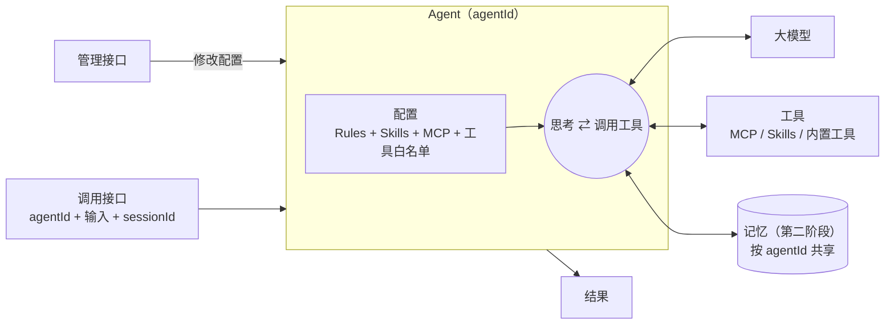
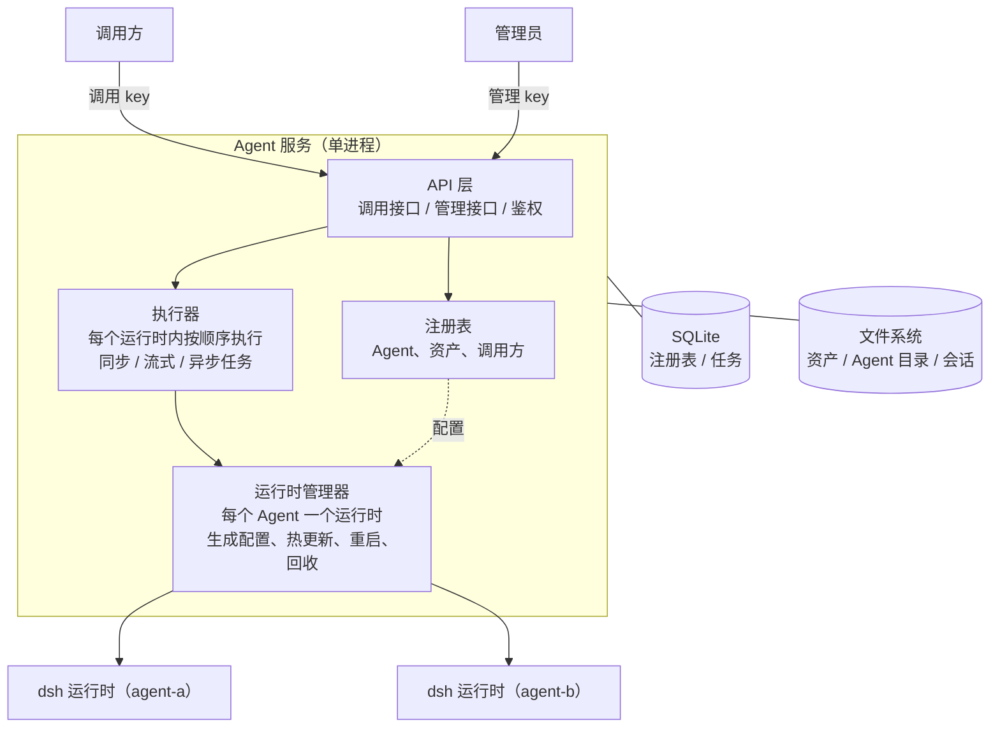
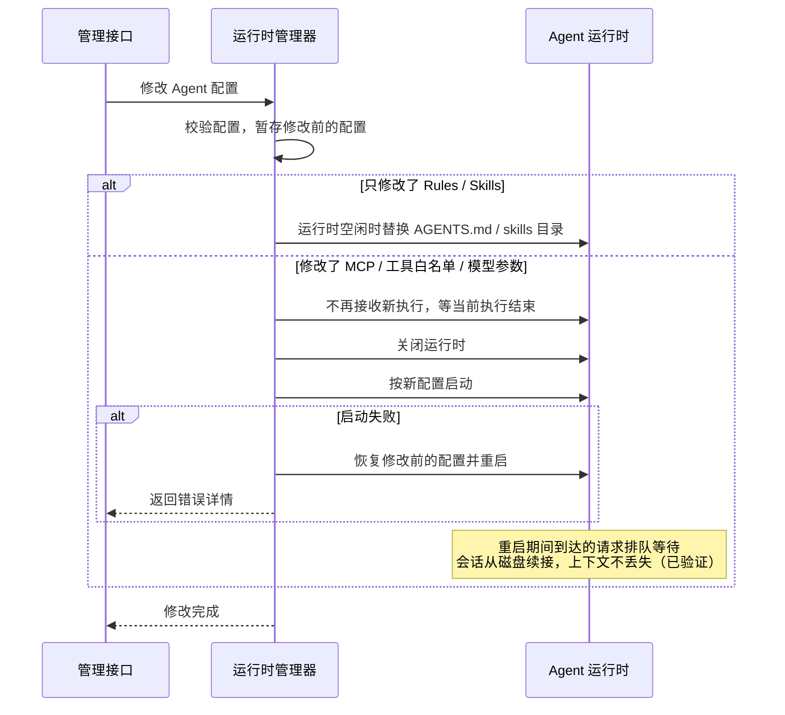

# 通用 Agent 服务设计

- 日期：2026-10-23
- 状态：设计已确认，未开始开发
- 基础：现有 dsh-server（FastAPI + DeepSeek Harness Python SDK `deepseek-harness-sdk==0.2.1rc2`）

## 1. 目标

搭建一个通用的 Agent 服务，供其他服务通过 API 调用。要求：

1. 其他服务通过 API 调用 agent，支持同步、流式和异步任务。
2. 可以动态配置每个 agent 的 Skill、MCP、Rules，不需要重新部署服务。
3. 可以接入记忆系统（第二阶段）。
4. 会话之间除了记忆外互相隔离。
5. 调用和配置分开：调用接口只能调用 agent，配置只能通过管理接口修改。

不在范围内：任何具体调用方的业务逻辑。调用方只是服务的使用者，服务本身不包含调用方相关的设计。

## 2. 核心概念

| 概念 | 说明 |
|---|---|
| **Agent** | 用 `agentId` 唯一标识，包含模型参数、Rules、Skills、MCP、工具白名单。调用方只需要知道 `agentId`。配置原地修改，没有版本 |
| **会话** | 一组多轮对话，属于某一个 Agent。不同会话之间上下文互相隔离 |
| **调用方** | 持有调用 key 的服务，只能调用被授权的 `agentId` |
| **资产** | Skill 和 MCP 连接登记在资产库里，Agent 按 ID 引用 |
| **记忆** | 按 `agentId` 划分，同一 Agent 的各会话共享（第二阶段） |

需要给不同场景使用不同的配置或记忆时，**复制出一个新 Agent**，而不是在调用时传配置。复制时只复制配置，不复制记忆。

## 3. Agent 的运行机制



## 4. 架构



- **每个 Agent 对应一个运行时进程**，有独立的 `DSH_HOME`。不同 Agent 的运行时并行执行，互不影响。
- **同一个运行时内按顺序执行**，沿用现有执行器。同一 Agent 内的并发能力放到第三阶段再做。
- 第一阶段使用 SQLite 加文件系统，服务以单进程部署，和现在一致。

## 5. 运行时管理

### 5.1 配置在运行时里的落地方式

每个 Agent 有一个固定的 `DSH_HOME`：

| 配置项 | 在运行时里的落地方式 | 修改后怎么生效 |
|---|---|---|
| Rules | `$DSH_HOME/AGENTS.md` | **热更新**：改文件后，下一轮请求生效，已有会话也会生效（已验证） |
| Skills | 复制到 `$DSH_HOME/skills/<名称>/` | **热更新**：运行时会监听目录变化（已验证） |
| MCP | patch 中插入 `@deepseek-ai/dsh-mcp-client` 行 | **重启运行时** |
| 工具白名单 | patch 中禁用对应的行，或者调整行的配置 | **重启运行时** |
| 模型参数 | 初始化运行时时传入 | **重启运行时** |

热更新只在运行时空闲时（两次执行之间）进行，避免一次执行中途配置发生变化。

### 5.2 工具白名单

通过 patch 实现（已验证）。服务提供几个预设，也允许逐项指定：

```yaml
# 预设 readonly：只能读文件和使用 skill
- id: tool-bash
  disabled: true
- id: tool-fs
  config: { write: false, edit: false }
# ……另外禁用 tool-jobs / tool-web / tool-subagent* / tool-workflow / tool-goal / plan-mode / tool-working-directory
```

| 预设 | 模型能用的工具 |
|---|---|
| `full` | sdk profile 的全部 25 个工具（bash、读写文件、web、子 agent 等） |
| `readonly` | `read`、`read_image`、`glob`、`grep`、`skill`、`todo_write` |
| `custom` | 按工具组单独开关（下面列出的 patch 行 id） |

可以控制的工具组：`tool-bash`、`tool-jobs`、`tool-fs`（细分为 `read`、`readImage`、`write`、`edit`）、`tool-fs-search`、`tool-web`、`tool-subagent`、`tool-subagent-fork`、`tool-subagent-control`、`tool-subagent-list-agents`、`tool-workflow`、`tool-goal`、`plan-mode`、`tool-todo`、`tool-skill`、`tool-working-directory`。

`plugin_manager` 和 `plugin_market`（agent 用来给自己装插件的工具）在 sdk profile 下本来就不加载，生成配置时再显式禁用一次作为兜底。

### 5.3 修改配置的流程



- 没有版本历史。修改前的配置只在这次修改过程中暂存，用来在失败时回滚。
- 重启只影响这一个 Agent，其他 Agent 不受影响。
- 重启耗时约 1.5 秒，再加上连接 MCP 的时间。

### 5.4 回收

- **按需启动**：Agent 第一次被调用时才启动运行时，约 1.5 秒。
- **空闲回收**：空闲超过 N 分钟后关闭运行时，下次调用再启动。
- **定期重建**：运行时不能卸载已加载的会话，空闲时约 215 MB，每加载一个会话大约多 20 MB。累计加载 K 个会话后，在空闲时重建运行时，释放内存。
- 设置全局运行时数量上限，超过时先回收空闲时间最长的运行时。

## 6. 目录结构

```
data/
├── service.db                          注册表、调用方、异步任务
├── assets/
│   └── skills/<skillId>/               上传的 skill
└── agents/<agentId>/
    ├── home/                           该 Agent 的 DSH_HOME
    │   ├── AGENTS.md                   Rules
    │   ├── skills/                     引用的 skill（从资产库复制）
    │   ├── agent.patch.yml             MCP、工具白名单
    │   └── sessions/                   会话
    └── workspace/                      运行时工作目录（沙箱的写入范围）
        └── <sessionId>/                会话自己的工作子目录
```

## 7. 接口

### 7.1 调用接口（调用 key）

| 方法 | 路径 | 说明 |
|---|---|---|
| POST | `/v1/agents/{agentId}/chat` | 同步调用 |
| POST | `/v1/agents/{agentId}/chat/stream` | SSE 流式 |
| WS | `/v1/agents/{agentId}/ws` | WebSocket，同一连接可以多轮对话 |
| POST | `/v1/agents/{agentId}/tasks` | 异步任务，立即返回 `task_id`，可选 webhook 回调 |
| GET | `/v1/agents/{agentId}/tasks/{taskId}` | 查询任务状态和结果 |
| GET/DELETE | `/v1/agents/{agentId}/sessions[/{sessionId}[/messages]]` | 会话列表、详情、历史、删除 |

请求体只有 `{"input": "...", "session_id": "可选"}`，**不接受任何配置参数**。返回的内容在现有格式的基础上增加 `agent_id`。

### 7.2 管理接口（管理 key）

| 资源 | 操作 |
|---|---|
| `/v1/admin/agents` | 创建、列出、读取、修改、删除；`POST /{agentId}/copy` 复制 |
| `/v1/admin/skills` | 上传（zip 包，必须包含 `SKILL.md`）、列出、修改、删除（被 Agent 引用时拒绝删除） |
| `/v1/admin/mcp-servers` | 登记连接（`stdio` 或 `streamable-http`）、修改、删除；凭据只能写入，读取时不返回 |
| `/v1/admin/callers` | 创建调用方并生成 key、授权可调用的 `agentId`、吊销 key |

Agent 配置示例：

```json
{
  "agent_id": "analyst",
  "description": "数据分析助手",
  "model": {"provider": "deepseek-official", "model": "deepseek-v4-flash", "reasoning_effort": "high"},
  "rules": "# 规则\n...",
  "skills": ["skill-a", "skill-b"],
  "mcp_servers": ["mcp-x"],
  "tools": {"preset": "readonly"},
  "permission_mode": "workspace-write"
}
```

修改某个 skill 或 MCP 连接时，所有引用它的 Agent 都会随之更新：skill 走热更新，MCP 走重启。

## 8. 安全

| 项 | 做法 |
|---|---|
| 调用与配置分离 | 两类 key，调用 key 不能访问 `/v1/admin` |
| 凭据 | MCP 凭据保存在服务里。patch 中只写 `!!js process.env.MCP_<id>_*` 这样的引用，真实值通过该运行时进程的环境变量传入，不以明文写进 patch 文件 |
| 自装插件 | 禁用 `plugin_manager` 和 `plugin_market` |
| 审批 | 服务没有人工审批通道，需要审批的操作一律自动拒绝（保持现状） |

**已知的隔离缺口**：bubblewrap 只限制写入，不限制读取；`read` 工具也可以读取任意路径。所以第一阶段的隔离程度是：

- 会话之间：上下文隔离；文件只做约定式隔离（每个会话一个子目录），防误操作，防不了恶意读取。
- Agent 之间：每个 Agent 的进程和写入范围是独立的，但**能读到其他 Agent 的目录**，也可能通过 `/proc` 读到同一用户下其他进程的环境变量（待验证）。

第一阶段的前提是：所有 Agent 由同一团队管理，属于同一个信任域。如果需要强隔离，到第四阶段引入容器执行后端（见第 11 节）。

## 9. 错误处理

沿用现有的错误码体系，另外增加：

| 场景 | 处理 |
|---|---|
| `agentId` 不存在，或调用方没有被授权 | 404 / 403 |
| 修改配置后运行时启动失败 | 回滚到修改前的配置并重启，管理接口返回错误详情 |
| MCP 服务连不上 | 不影响运行时启动和其他工具（已验证）。默认 `failOnStartupError: false`，后台自动重连 |
| 运行时崩溃 | 下一次请求时自动重启，会话从磁盘恢复（现有逻辑） |
| 运行时数量达到上限，且没有可回收的运行时 | 429 |

## 10. 测试

- **单元测试**：沿用 `tests/fake_dsh.py` 模拟运行时，覆盖注册表、鉴权、路由、配置修改流程（热更新、重启、失败回滚）。
- **集成测试**：使用真实运行时，通过环境变量开启（需要 API Key）。覆盖本文中所有标注"已验证"的行为：工具白名单、rules 热更新、多运行时并行、重启后续接会话。

## 11. 分阶段计划

| 阶段 | 内容 |
|---|---|
| **一：核心服务** | Agent 注册表、管理接口、调用接口（同步、流式、WebSocket、异步任务）、运行时管理器（生成配置、热更新、重启、回收）、两类 key |
| **二：记忆** | 见第 12 节 |
| **三：并发与输出** | 同一 Agent 支持多个运行时实例；`output_schema` 结构化输出（校验不通过时追加一轮修正） |
| **四：强隔离** | 容器执行后端：每个 Agent 一个容器，或者从预热池中为每个会话分配一个容器，会话状态在外部存储，按需注入和回收 |

## 12. 记忆（第二阶段，已确定的部分）

- **范围**：按 `agentId` 划分。复制 Agent 时不复制记忆。
- **写入**：三种来源都支持，每条记忆标注来源：
  - `manual`：通过管理接口人工写入，优先级最高，自动流程不能覆盖或删除。
  - `agent`：agent 通过记忆 MCP 的 `memory_write` 主动写入。
  - `auto`：每次调用结束后，对新增的对话内容做增量提取。按 Agent 设置开关，默认打开，在后台异步执行。
- **读取**：调用开始时自动注入少量相关记忆和全部 `manual` 记忆；之后 agent 需要时再用 `memory_search` 检索。
- **实现方式**：服务自己提供一个记忆 MCP 端点，生成运行时配置时自动接入，用 Agent 专属的 token 识别是哪个 Agent。

存储选型、检索方式、去重和冲突处理，在第二阶段开始前再设计。

## 13. 技术验证记录

| # | 验证点 | 结论 |
|---|---|---|
| 1 | 用 patch 禁用工具 | 可行。`- id: <行id>` 加 `disabled: true`；`tool-fs` 支持 `write: false`、`edit: false`。`readonly` 预设下工具从 25 个降到 6 个，写文件确实被阻止 |
| 2 | 全局 rules | 文件是 `$DSH_HOME/AGENTS.md`；运行时不重启，修改后下一轮就生效，对已有会话同样生效 |
| 3 | 多运行时并行 | 各用独立的 `DSH_HOME` 时，skill 和 rules 互不串用；即使会话 ID 相同也互不冲突；执行是真正并行的；不会写 `~/.dsh`、`~/.agents` |
| 4 | 配置变更后续接会话 | 修改工具配置并重启运行时后，旧会话上下文完整保留，并且立即使用新的工具集。会话锁可以防止两个运行时同时写同一个会话，所以必须先关闭旧运行时，再启动新运行时 |
| 5 | MCP（此前已验证） | `stdio` 和 `streamable-http` 都可用；连不上不影响启动；`failOnStartupError: false` 时会自动重连 |
| 6 | Skill 热加载（此前已验证） | 运行中新增的 skill 不用重启就能使用 |
| 7 | 资源（此前已测） | 运行时启动约 1.4 秒，空闲约 215 MB，每加载一个会话约多 20 MB |

## 14. 待验证

1. 用 `set_working_directory` 把会话切到 `workspace/<sessionId>` 子目录后，沙箱写入是否正常，会话目录的归属是否受影响。
2. 在 bubblewrap 沙箱里，agent 能否读取其他运行时进程的 `/proc/<pid>/environ`。这决定"凭据通过环境变量传入"是否足够安全。
3. 一个运行时内的多个会话能否并发执行。这决定第三阶段是"增加运行时实例"还是"让单个运行时内并发"。
